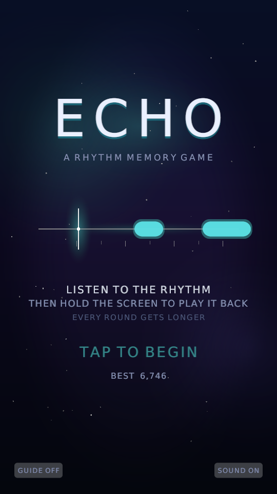
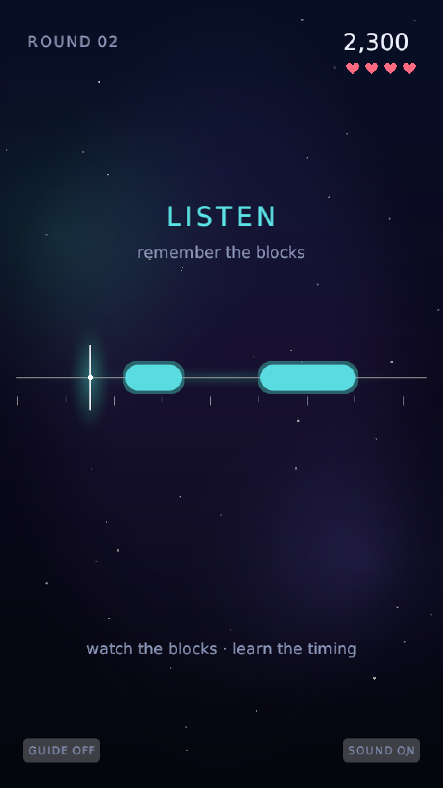
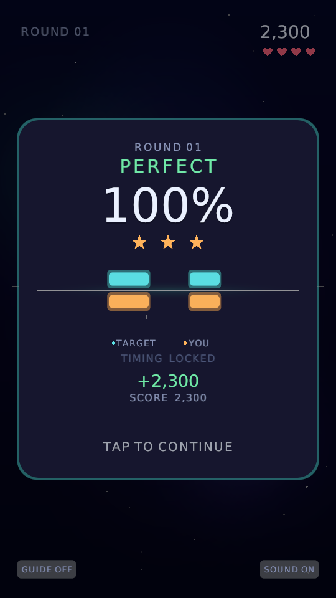

# ECHO — a rhythm memory game

A portrait (9:16) 2D rhythm-memory game for phones, made with Unity 6000.6.6f1.

One staff line runs across the screen. **Blocks are holds**; the space between them is
just timing. Listen to a rhythm, then hold the screen to play it back from memory.
Every round is a new rhythm and every round is longer.

| Title | Listen | Perfect round |
| --- | --- | --- |
|  |  |  |

More previews: `Screenshots/countdown.png`, `Screenshots/play.png`,
`Screenshots/result_miss.png`.

## The loop

1. **Listen** — the staff scrolls past the playhead and each hold plays a note.
2. **Your turn** — the target is hidden. Hold anywhere to draw blocks; release to end a block.
   Your performance is recorded as amber blocks as you play.
   With **GUIDE** on, the target stays visible as faint cyan ghost blocks to follow.
3. **Compare** — both performances are laid over the same staff line:
   cyan = target, amber = you, red ghost blocks = target holds you missed.
   The hold-match percentage decides whether the round is cleared.
4. **Every round grows** — one extra hold every **two** cleared rounds (2 → 5 holds max).
   **4 hearts** per run. A failed round replays the **same rhythm** so you can learn it;
   a cleared round is replaced by a new, longer one. 92%+ is a 3-star round.

## Run it

- Open the project in **Unity 6000.6.6f1**.
- Open `Assets/Rhythm/Scenes/Rhythm.unity`.
- Press **Play**.

Controls: hold the mouse / touch / Space to make a block; release to end it.
**M** (or the SOUND pill) toggles audio. **G** (or the GUIDE pill) toggles Guide mode:
the target's blocks stay visible as faint ghosts during your turn. The setting persists.

## Build

- `Tools > Echo > Setup Project` — re-applies portrait + Android player settings,
  rebuilds the scene, and adds it to Build Settings.
- `Tools > Echo > Build Android APK` — writes `Builds/Echo.apk`.
  Android is configured portrait-only, portrait-upside-down and landscape disabled,
  ARM64 / IL2CPP, min SDK 26, package `com.echogames.echo`.
  Build output is excluded from version control.

## Design notes

- **9:16 first**: CanvasScaler in `Expand` mode with a 1080×1920 reference, so the whole
  stage always fits; the background bleeds to any phone aspect. Safe-area insets push the
  HUD and bottom controls out of notches.
- **No assets**: every sprite is generated from SDF-style drawing at runtime and every
  sound is synthesised procedurally (a pentatonic bell melody for the target, and the
  same bells for the player's holds).
- **Hold feedback**: each hold plays the **target's own bell note** at that point in the
  staff — same pitch and timbre — so the player's rhythm sounds like the target's groove.
  Releasing fades the note. There is no separate drone layer.
- **Audio-synced clock**: phase timing is driven by `AudioSettings.dspTime`, so the staff,
  playhead and music stay locked together.
- **Hold-only scoring**: only hold blocks are judged. Coverage = how much of the target's
  hold time you covered; precision = how much of your own holding landed inside target
  holds. Score = coverage × precision. The whole take can slide ±350 ms for alignment and
  target holds get ±150 ms of edge slack. Silence = 0%, a clean reproduction = 100%,
  and holding through the space between blocks lowers precision. The pass bar is **65%**;
  stars sit at 92% / 80% / 65%. Timing differences are displayed on the result card.
- **Guide mode**: a persisted toggle that keeps the target's blocks on the staff at 30%
  opacity during the player's turn, so you can follow the pattern while still playing it.
  The prompt switches to “follow the ghost blocks” and the result card is tagged GUIDE.
- **Learning-friendly pacing**: rounds 1–2 use two holds, then one more hold every two
  rounds (capped at five), with a 1.0–1.25 s lead-in before the first hold.
- **One line**: the target lane sits above the shared staff and the player lane below it,
  time-aligned, so the same line shows both recordings.

## Source map

```
Assets/Rhythm/Scripts/
  EchoGame.cs      screens, state machine, input, HUD, particles
  TapeView.cs      the scrolling staff, blocks, playhead, comparison view
  RhythmModel.cs   rhythm generation + hold-match score
  Synth.cs         procedural music, hold bells and SFX
  UiKit.cs         palette, generated sprites, text helpers, letter spacing
Assets/Rhythm/Editor/EchoSetup.cs   portrait/Android configuration, scene + build menu
```

### Debug helpers

`EchoGame` exposes a few inspector fields used while tuning (all off by default):
`debugAutoPerfect`, `debugCapture`, `debugTap`, `debugPhase`.
In the editor, **P** during the play phase instantly records a perfect performance.
